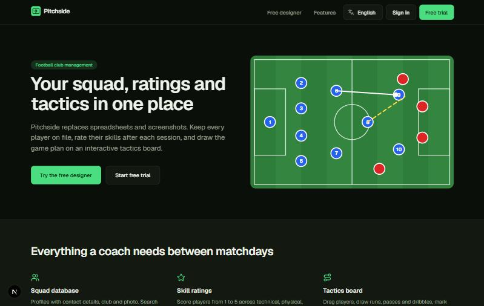
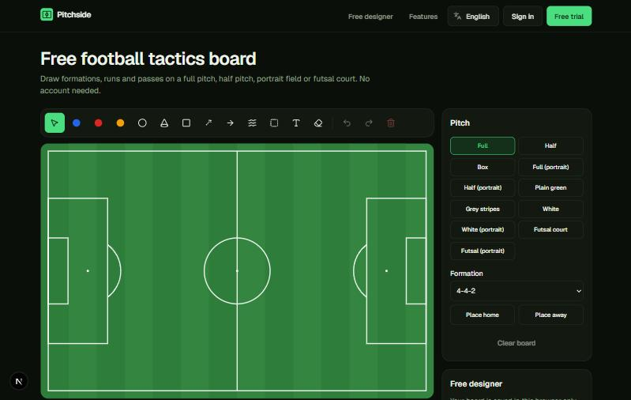
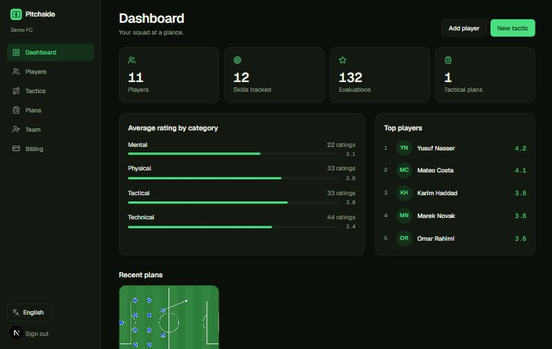
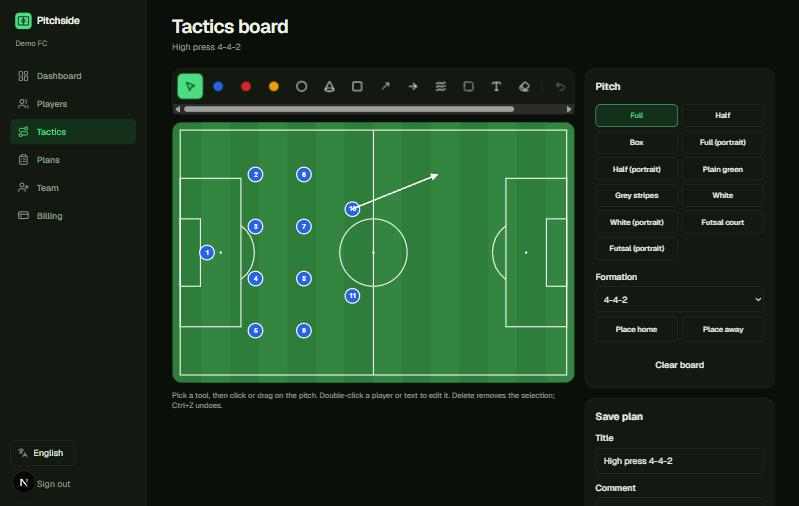
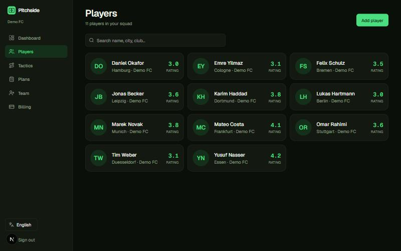
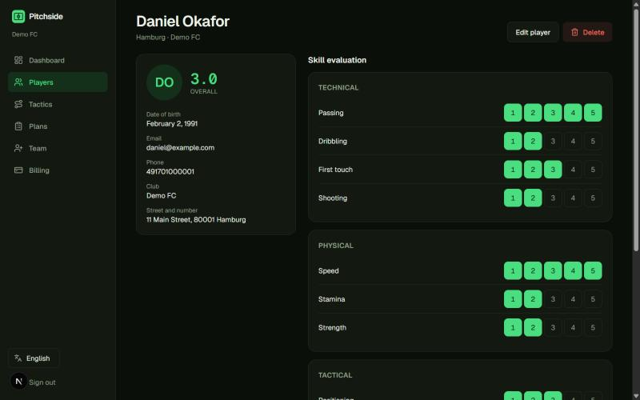
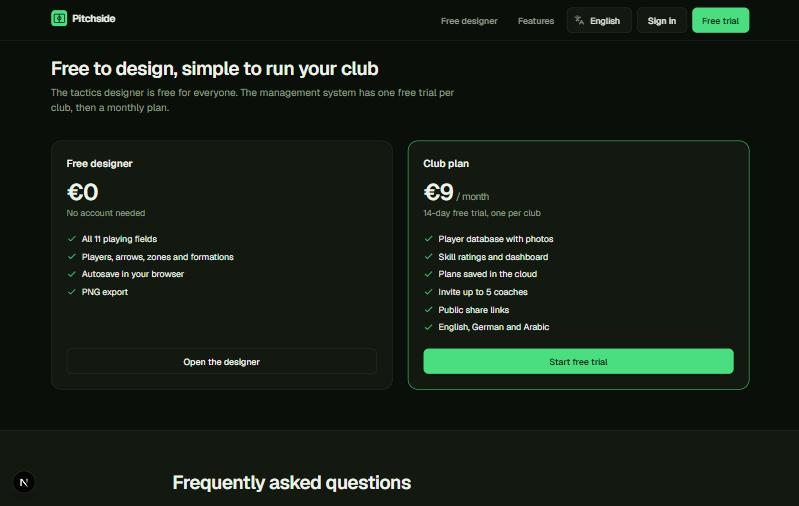
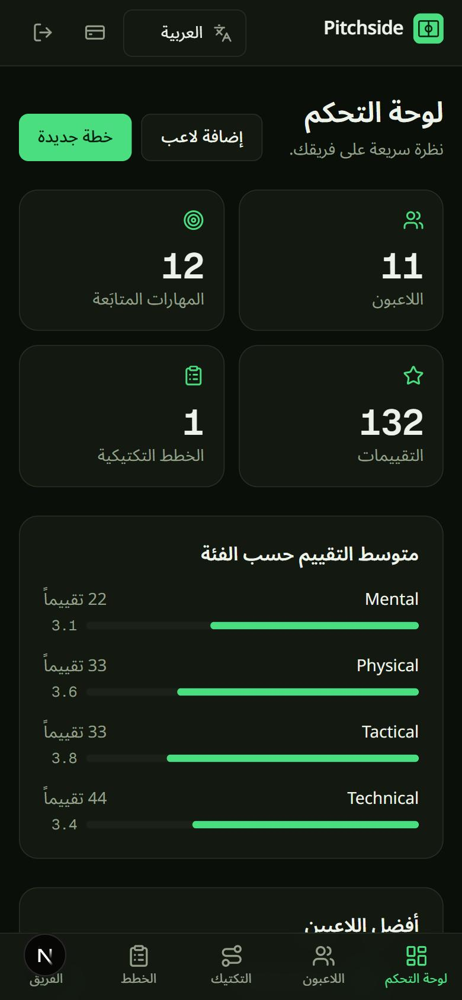
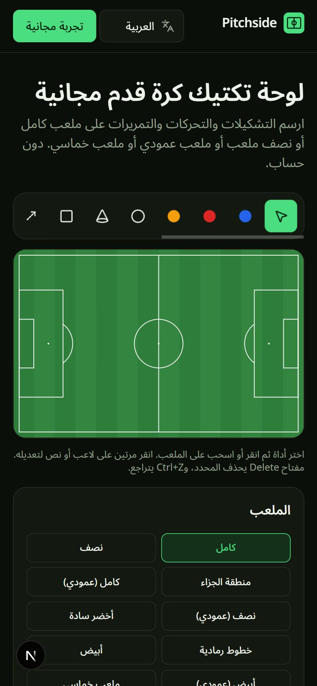

# Pitchside — frontend

[](https://patreon.com/AliIbrahim870)

Football club management in the browser: a **free tactics designer** (no account), plus a paid **club management system** with player database, skill ratings, cloud-saved plans, team invites and share links. Next.js (App Router, SSR) in **English and Arabic (RTL)**. The API is the sibling repo **footballClub-backend** (Django REST + PostgreSQL).

**Live demo:** https://aliibrahim996.github.io/footballClub-frontend/ (the free designer and public pages; the club system needs the API, see below).

## Engineering highlights
A 2021 server-rendered Django project that embedded a third-party tactics tool in an iframe, rebuilt as a split **Django REST API + Next.js frontend**. The parts I would point a reviewer to:

- **Native tactics board** (`src/components/board`): an SVG editor with pointer events and no drawing library. Eleven pitch layouts (full, half, penalty box, portrait, futsal and more), home/away/neutral players, runs, passes, dribbles, zones, text, one-click formations, undo/redo, keyboard shortcuts, PNG export through a canvas, and save/reopen of both the image and the editable board JSON.
- **Play simulation** (full version): a plan is a sequence of steps; coaches drag players to where they go next, see dashed movement trails, tag the plan (attack, defense, set piece, ...) and press Play to watch it unfold. Positions are interpolated with a CSS-equivalent cubic-bezier easing (the same curve as the site's `--ease-in-out` token); reduced-motion users get the same steps without gliding.
- **Motion with restraint**: a CSS-keyframe mini-play in the landing hero that explains the product, scroll reveals that only hide content when JavaScript can reveal it, and reduced-motion variants that drop movement but keep fades.
- **Two languages, including right-to-left**: English and Arabic with `next-intl`, locale-prefixed routes, logical CSS (`ps-`, `start-`, `border-e`) so the layout mirrors correctly, and API error messages localized through `Accept-Language`.
- **Server rendering and SEO**: SSR public pages, per-language canonical and `hreflang` tags, JSON-LD, `sitemap.xml`, `robots.txt`, and an `llms.txt` for AI crawlers.
- **Auth without tokens in JavaScript**: the API token lives in an `httpOnly` cookie and the browser only talks to a same-origin proxy route that adds it (no CORS to configure). The proxy rejects path-escape tricks and forwards the client IP so rate limits work per visitor.
- **Several ways to ship the same code**: a Docker standalone image, a **static export** (`npm run build:static`) published to GitHub Pages with sub-path handling, and GitHub Actions for lint, build, Docker build and Pages deployment. A set of build-time switches (`SIGNUPS_OPEN`, designer-only mode, contact mode) lets one codebase run as a free demo or as the full product.
- **Product thinking**: a freemium model (free designer, club system by request) with the trial, billing, team-invite and share-link features already built but switched off until needed.
- **Process**: a structured code review of the whole change set found ten issues (rate limits shared behind a proxy, leaked invite tokens, a missing database fallback guard, and others); all were fixed and re-verified.

```
browser ──► Next.js (SSR, en/ar) ──► Django REST API ──► PostgreSQL
                │  httpOnly cookie, same-origin proxy        └─ uploads: disk | S3 | GCS | Azure
                └─ static export ──► GitHub Pages (designer-only demo)
```

### Honest limits
- No automated frontend tests yet: quality is enforced with ESLint, the type-checked production build, CI, and browser walkthroughs I ran by hand.
- The full club system is not publicly hosted; the live demo is the designer-only build. The Cloud Run and Android APK workflows are written but untested.
- The legal pages are drafts, not legal advice.
## Screenshots

| Landing page | Free tactics designer |
|---|---|
|  |  |

| Dashboard | Tactics board with saved plan |
|---|---|
|  |  |

| Players | Skill evaluation |
|---|---|
|  |  |

| Pricing | Arabic (RTL) on mobile |
|---|---|
|  |   |

> Screenshots use fictional demo data.

## Support the project
If Pitchside is useful to you, you can support its development on **[Patreon](https://patreon.com/AliIbrahim870)**. Thank you!

The tactics board is a native SVG editor that replaced the old third-party iframe.

## Requirements
- Node.js **22+** (Tailwind v4 needs ≥ 20.19)
- A running API (see below)

## Run locally
```bash
cp .env.example .env.local      # BACKEND_URL defaults to http://127.0.0.1:8000
npm install
npm run dev                     # http://localhost:3000  (redirects to /en)
```
Demo login: seed the API with `python manage.py seed --admin` (with `DJANGO_DEBUG=1`); it prints the generated `admin` password once, or uses `SEED_ADMIN_PASSWORD` if you set it. No default credentials ship with the project.

## Docker
```bash
docker compose up --build                     # frontend only, API at BACKEND_URL (default host:8000)
docker compose --profile with-api up --build  # also builds ../footballClub-backend + PostgreSQL
```
Set `NEXT_PUBLIC_SITE_URL` to your public origin (used for sitemap, canonical and hreflang URLs) and `COOKIE_SECURE=1` behind HTTPS.

## How it works
- `src/app/[locale]/…` — all pages; `(marketing)` is public + crawlable, `(app)` requires login (`src/proxy.ts`).
- Auth token lives in an httpOnly cookie. Browser calls go to `/api/*`, a same-origin proxy that adds the token and forwards `Accept-Language`, so Django returns messages in the UI language. `/media/*` is rewritten to the API.
- `src/components/board/` — SVG tactics board: pitches (full/half/box/blank), players, ball, cones, goals, runs/passes/dribbles, zones, text, formations, undo/redo, PNG export, save to API.
- SEO/AI: server-rendered pages, per-locale metadata + hreflang, JSON-LD (Organization, SoftwareApplication, FAQPage), `sitemap.xml`, `robots.txt` (AI crawlers allowed on public pages), `public/llms.txt`.
- Translations: `messages/{en,ar}.json` (keep keys identical).

## Product model
- **Free:** the tactics designer at `/designer` (no account, autosaves in the browser, PNG export; ads optional).
- **Full version (early access):** the club management system (players, ratings, cloud plans, team invites, share links). While `NEXT_PUBLIC_SIGNUPS_OPEN` is `0` visitors are sent to a **contact us** page. Opening sign-ups later enables the one-time 14-day free trial and Stripe subscription (already built).
- **GitHub Pages:** `npm run build:static` exports the designer-only site to `out/` and `.github/workflows/pages.yml` publishes it (see [docs/DEPLOY.md](docs/DEPLOY.md#github-pages-free-static-hosting-for-the-designer)). No login, club system or contact API there.
- **Free hosting:** `NEXT_PUBLIC_DESIGNER_ONLY=1` runs only the public pages and the free designer with no backend or database. See [docs/DEPLOY.md](docs/DEPLOY.md#launch-for-free-designer--contact-us-no-backend-no-database) for hosts, Stripe, ads, Google Cloud and the Android APK.

## Scripts
`npm run dev` · `npm run build` · `npm run lint`
